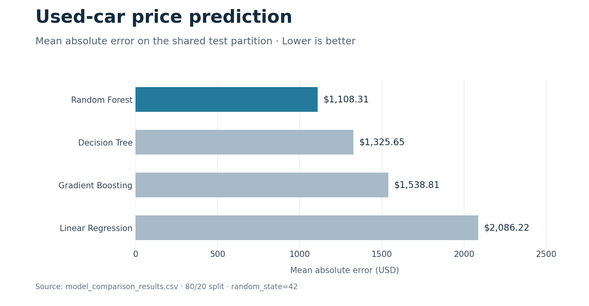

# Used Car Price Prediction

A Python regression project that estimates used-car prices in USD from vehicle specifications. It compares four models and exports a Random Forest pipeline with preprocessing included.

**Author:** Igor Jovanovic

The committed Random Forest model achieves **MAE of $1,108.31**, **RMSE of $2,846.21**, and **R² of 0.8793** on the project's held-out test partition.

## What it demonstrates

The project shows a complete tabular machine-learning workflow: exploratory analysis, data cleaning, engineered features, preprocessing fitted on training data, model comparison, and evaluation of a saved model.

A similar workflow can support inventory analysis and pricing estimates. The results here describe the supplied historical dataset rather than present-day market prices.

## Data and cleaning

| Dataset | Rows | Columns |
|---|---:|---:|
| Original: `cars.csv` | 56,244 | 12 |
| Cleaned: `cars_clean.csv` | 56,157 | 12 |
| Engineered: `cars_features.csv` | 56,157 | 16 |

The target is `priceUSD`. Vehicle attributes include make, model, year, mileage, condition, fuel type, engine volume, color, transmission, drive unit, and segment.

Cleaning removes 87 exact duplicate rows. Mileage above 1,000,000 km and engine volume above 8,000 cm³ are replaced with missing values, then handled by the preprocessing pipeline. High prices are retained rather than automatically removed.

## Features and preprocessing

Four additional features are created:

| Feature | Meaning |
|---|---|
| `car_age` | Vehicle age relative to the dataset reference year |
| `mileage_per_year` | Mileage divided by age, with a minimum denominator of one |
| `engine_volume_liters` | Engine volume converted from cm³ to liters |
| `brand_model` | Combined make and model |

The supplied data uses **2020** as its reference year, derived from the maximum manufacturing year plus one. Inputs to the saved model must preserve that reference year when engineering age features.

A scikit-learn `ColumnTransformer` combines median imputation and scaling for four numeric features with most-frequent imputation and one-hot encoding for nine categorical features. `OneHotEncoder(handle_unknown="ignore")` accepts unseen category values. Preprocessing and the regressor are saved together in a `Pipeline`.

## Evaluation and model comparison

All four models use the same **80/20 split**, with `random_state=42`: 44,925 training rows and 11,232 test rows. Preprocessing is fitted on the training partition.

| Model | MAE (USD) | RMSE (USD) | R² |
|---|---:|---:|---:|
| Random Forest | **1,108.31** | **2,846.21** | **0.8793** |
| Decision Tree | 1,325.65 | 3,367.61 | 0.8310 |
| Gradient Boosting | 1,538.81 | 3,006.97 | 0.8653 |
| Linear Regression | 2,086.22 | 4,325.96 | 0.7212 |



Source: [model_comparison_results.csv](model_comparison_results.csv). Running `model_evaluation.py` with the committed artifact reproduces the displayed Random Forest metrics.

MAE is the average absolute price error on this test partition. R² measures explained variance; it is not a classification accuracy percentage. The notebook also evaluates a log-target Random Forest: its slightly lower MAE comes with worse RMSE and R², so the standard Random Forest is retained.

Final model configuration:

```python
RandomForestRegressor(
    n_estimators=200,
    random_state=42,
    n_jobs=-1,
    max_depth=20,
    min_samples_leaf=2,
)
```

## Run locally

Python 3.12 was used to verify the saved pipeline. scikit-learn is pinned to **1.9.0** to match the committed artifact.

```bash
git clone https://github.com/IgorJovanovic3/IMLP6-Task4-Car-Price-Prediction.git
cd IMLP6-Task4-Car-Price-Prediction
python -m venv .venv
```

Activate the environment:

- Windows PowerShell: `.\.venv\Scripts\Activate.ps1`
- macOS/Linux: `source .venv/bin/activate`

Install dependencies and evaluate the existing model:

```bash
python -m pip install -r requirements.txt
python model_evaluation.py
```

The script prints regression metrics and ten examples of actual versus predicted prices. Its terminal messages are currently in Serbian.

To rebuild the workflow from the input CSV:

```bash
python data_cleaning.py
python feature_engineering.py
python data_preprocessing.py
python model_training.py
python model_evaluation.py
python model_comparison.py
```

These steps overwrite the generated datasets, model artifact, and comparison CSV.

## Use the saved pipeline

The saved pipeline expects engineered features, including `car_age`, `mileage_per_year`, `engine_volume_liters`, and `brand_model`. This example predicts one row from the supplied feature dataset:

```python
import joblib
import pandas as pd
from data_preprocessing import prepare_xy

features, _ = prepare_xy(pd.read_csv("cars_features.csv"))
pipeline = joblib.load("car_price_model.joblib")
predicted_price = pipeline.predict(features.head(1))[0]
print(f"Estimated price: ${predicted_price:,.2f}")
```

## Project files

| File | Purpose |
|---|---|
| `car_price_analysis.ipynb` | Exploratory analysis, experiments, plots, and error analysis |
| `data_cleaning.py` | Duplicate removal and invalid-value handling |
| `feature_engineering.py` | Additional vehicle features |
| `data_preprocessing.py` | Feature selection and preprocessing definitions |
| `model_training.py` | Random Forest training and pipeline export |
| `model_evaluation.py` | Evaluation of the saved pipeline |
| `model_comparison.py` | Training and comparison of four regressors |
| `car_price_model.joblib` | Saved preprocessing and Random Forest pipeline |
| `docs/create_figures.py` | Recreates the comparison chart from the results CSV |

## Limitations and next steps

Rare or expensive vehicles can have large prediction errors. The random holdout does not measure future-market performance or transfer to another region, and the historical data does not capture current pricing conditions. A next iteration could add time-based evaluation and a prediction interface that consistently engineers incoming vehicle features.
